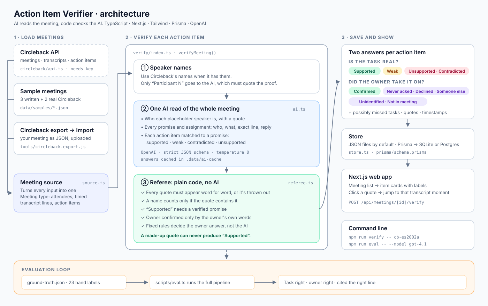

# Action Item Verifier

AI notetakers sometimes write action items nobody agreed to, or name the wrong owner. Circleback's own guide,
[How Circleback writes meeting notes and how to check them](https://circleback.ai/blog/how-circleback-writes-meeting-notes),
asks users to check each one by hand: confirm the owner is a real person, then find the matching moment
in the transcript. This project does that check automatically.

Every action item gets **two answers**:

| Is the task backed by the transcript? | Did the named owner take it on? |
|---|---|
| **Supported**: someone committed to it or was given it | **Confirmed**: a clear yes from the owner ("I'll do it", "yes, on it") |
| **Weak**: discussed but nobody took it on, or only a paraphrased quote backs it | **Weak yes**: a maybe ("I'll try", "let me check my calendar") |
| **Unsupported**: not in the transcript | **Declined**: the owner said no |
| **Contradicted**: the transcript says the opposite | **Never acknowledged**: given to them, no reply |
| **Not checked**: the AI skipped this item; verify again | **Someone else took it**: a different person committed |
| | **Unidentified**: the owner is "Participant 4" and nothing says who that is |
| | **Not in meeting**: the named person wasn't there |

When the meeting points to a different owner, it **suggests the fix** with the quote attached: reassign
("Priya: I'll take it" when Circleback named Raj), add a co-owner ("Raj and I will split it"), or
reassign to someone volunteered by a colleague ("Sam's got it", marked as not yet confirmed by Sam).
That's a correction you could write straight back to Circleback by changing the assignee.

It also lists **promises the notetaker may have missed**: commitments with no matching action item.

Built with Circleback's stack: TypeScript, Next.js, React, Tailwind, Prisma, and Postgres or SQLite. Uses OpenAI.

## Quick start

```bash
npm install
cp .env.example .env        # then paste your OPENAI_API_KEY into .env
npm run dev                 # http://localhost:3000
```

Open a meeting and click **Verify with AI**. Each meeting costs a few cents. Answers are cached in
`.data/ai-cache`, so verifying the same meeting again is free.

```bash
npm test                          # tests for the referee rules (uses a fake AI, no key needed)
npm run eval                      # score the AI against the hand labels
npm run eval -- --model gpt-4.1   # compare another model
npm run verify -- cb-es2002a      # verify one meeting in the terminal
```

## How it works



**1. Speaker names.** Circleback's names are used whenever it has them. Only speakers still called
"Participant N" are sent to the AI to identify, and the AI must quote the line that shows who they are.

**2. One AI read per meeting** (`src/lib/verify/ai.ts`). The AI gets the whole transcript and the action
items, and returns structured JSON:
- who each placeholder speaker is, with a quote
- every promise and assignment: who, what, the exact line, and the owner's reply
- for each action item: which promise it matches and whether the task is supported, weak,
  contradicted, or unsupported

**3. The referee** (`src/lib/verify/referee.ts`). Plain code, no AI. The AI only reports facts; the referee
decides:
- Every quote must appear word for word in the transcript line it cites, in any language (accents,
  Japanese, and so on). One-word fragments and punctuation-only quotes are thrown out.
- A close paraphrase (60%+ of its words in the line) is kept and marked "paraphrased", but it can't
  prove more than Weak. Anything further off is thrown out.
- A speaker name is accepted only if the quote contains the name, and either the speaker introduces
  themselves near the start of their line, or someone else names them and they talk right after.
- "Supported" requires a verified promise. Without one it is downgraded.
- The owner "confirmed" only on a clear yes in the owner's own words; a maybe is "Weak yes", and a
  reply from someone else doesn't count.
- Names match loosely: "Dan" matches "Daniel Kim", but "Dan Lee" doesn't, and placeholders must match exactly.
- An item the AI skipped is "Not checked", never "Unsupported".
- The owner answer (confirmed, never acknowledged, someone else, and so on) is decided by fixed rules,
  not by the AI.
- A suggested owner must either speak in the meeting or be named in the quoted line. A "self" promise
  that doesn't list its own speaker is treated as a hand-out, so a manager giving out roles isn't
  suggested as co-owner.

A made-up quote can't produce a "Supported" or "Confirmed". Everything the referee rejects is listed
on the meeting page.

## Real Circleback meetings

`data/samples/cb-es2002a.json` and `cb-es2008a.json` are real Circleback output. The audio is from the
[AMI Meeting Corpus](https://groups.inf.ed.ac.uk/ami/corpus/) (CC BY 4.0), uploaded to Circleback, which
produced the transcript and action items. The other three sample meetings were written by hand with
planted mistakes.

Things these meetings show:
- Uploaded recordings have no calendar invite, so **Circleback labels every speaker "Participant N"**,
  even when its notes name people (Andrew, Greg, David, Rose). The names are never linked to the transcript.
- **Real meetings mostly assign tasks rather than volunteer them.** The project manager gives out work by
  role ("as the industrial designer you're gonna…"), and most owners never reply.
- **The transcript can split one sentence across two speakers** ("I'll" / "look into it"), which makes a
  real commitment hard to check.

## Evaluation

`data/ground-truth.json` holds hand labels for 23 action items (17 written, 6 real): the task answer,
the owner answer, and which transcript lines show it. `npm run eval` reports:

- task answer right
- owner answer right
- both right
- **cited the right transcript line**: checks the evidence, not just the label
- both right on real Circleback meetings only

Run it with your key and put the numbers here. The real-meeting labels were written by one person; some
calls are debatable (is Andrew's "Okay." agreement?). A second person labelling independently would make
them stronger.

## Importing your own Circleback meetings

No API key needed:

1. Open the meeting in Circleback while signed in.
2. Open DevTools → Console, paste `tools/circleback-export.js`, and press Enter. A JSON file downloads.
3. In the app, click **Import** and upload that file.

The script reads the same endpoints the Circleback web app uses to show you your meeting. They aren't a
documented public API, so they may change.

## Connecting through the Circleback API

1. Create an API key in Circleback under **Settings → API keys**.
2. In `.env`, set `MEETING_SOURCE="api"` and `CIRCLEBACK_API_KEY=...`.
3. Check the endpoint paths and field names in `src/lib/circleback/api.ts` against
   https://circleback.ai/docs/api. They are best guesses kept in one place.

## Saving results

Results are saved as JSON in `.data/runs` by default. To use Prisma instead, run `npm run db:setup`
and set `STORAGE="prisma"` in `.env`. For Postgres, change `provider` in `prisma/schema.prisma`.

## Limits

- Meetings longer than about 100k tokens of transcript aren't split yet.
- Answers depend on the model. Use `npm run eval -- --model ...` to compare.
- No offline mode: verifying needs an OpenAI key.

## Project layout

```
src/lib/verify/        ai.ts (OpenAI reader + cache), referee.ts (checks + decisions), text.ts
src/lib/circleback/    api.ts (API adapter), source.ts (files vs API), validate.ts (import schema)
src/app/               Next.js pages, /import, POST /api/meetings/[id]/verify, POST /api/import
tools/                 circleback-export.js (browser console export)
data/samples/          3 written meetings + 2 real Circleback meetings
data/imported/         meetings you import
scripts/               eval.ts, verify.ts
tests/                 referee tests with a fake AI
```

## Credits

Meeting audio for `cb-es2002a` and `cb-es2008a` is from the AMI Meeting Corpus, released under
[CC BY 4.0](https://creativecommons.org/licenses/by/4.0/). Transcripts and action items were generated by Circleback.
